# VETRA v2.0 — Side and back view keypoints for cattle type traits

Second iteration of the **VETRA (Vision-Enabled Type Recording Assistant)** ML pipeline. It trains two YOLOv8n-pose models, one for **side-view** photos (10 keypoints) and one for **back-view** photos (8 keypoints), extracts 12 linear and angular body measurements, and prototypes a type/breed classifier with a 1–9 trait-score report.


<p align="center">
  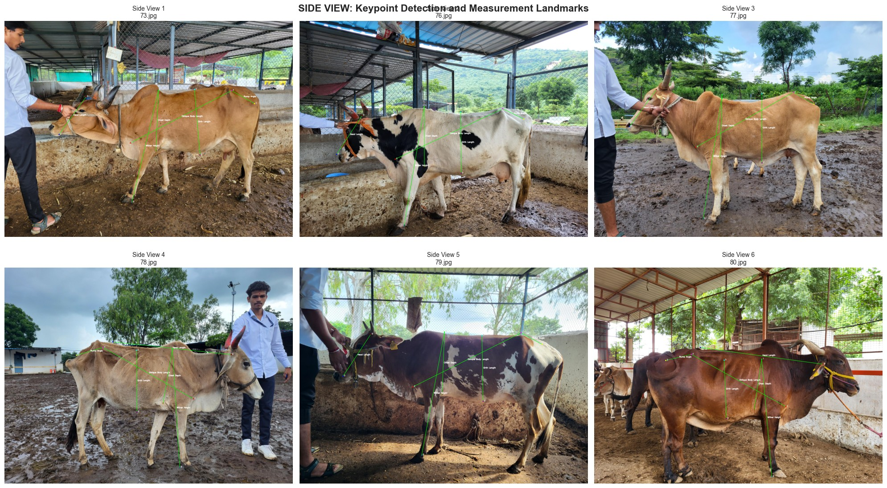
</p>

> [!NOTE]
> **Archived.** The same notebooks were retrained and wrapped in a web app in [VETRA-v2.2-with-app](https://github.com/rupeshbharambe24/VETRA-v2.2-with-app). The final models are in [VETRA-v3.0](https://github.com/rupeshbharambe24/VETRA-v3.0), served by [VETRA---App](https://github.com/rupeshbharambe24/VETRA---App).

## Contents

- [Overview](#overview)
- [What's new in this version](#whats-new-in-this-version)
- [Pipeline](#pipeline)
- [Results](#results)
- [Honest caveats](#honest-caveats)
- [Missing artefacts](#missing-artefacts)
- [Project structure](#project-structure)
- [Getting started](#getting-started)
- [Dataset](#dataset)
- [VETRA project map](#vetra-project-map)
- [License](#license)

## Overview

**Problem.** Animal Type Classification (ATC) for cattle and buffalo scores linear traits such as body length, height at withers, chest depth, rump angle and hip width. Manual scoring is slow and subjective. VETRA (Smart India Hackathon 2025) does it from smartphone photos.

**Approach.** Two pose models localise anatomical landmarks. Keypoint-pair distances become measurements through per-measurement pixel-to-cm factors. A rule-based layer maps the measurements to 1–9 trait scores and writes a BPA-style JSON record (`results/enhanced_bpa_output.json`).

**Highlights**
- Separate keypoint schemes per view:
  - side (10 kp): head length, oblique body length, girth, chest depth, withers height, rump angle
  - back (8 kp): rump width, hip width, tail length, left/right hip height, thurl width
- Reproducible 70/10/20 train/val/test split, built automatically from raw image and label folders (Step 1.4–1.6).
- Keypoint visualisation, comparative side/back analysis and measurement overlays.
- End-to-end function `complete_vetra_pipeline(side_img, back_img)` that returns measurements, type/breed and trait scores as JSON.

## What's new in this version

Changes since [VETRA-v1.1](https://github.com/rupeshbharambe24/VETRA-v1.1):

| | v1.1 | v2.0 |
|---|---|---|
| Views | side only | side **and** back (two models) |
| Keypoints | 6 (3 measurement pairs) | 10 side + 8 back |
| Measurements | 3 (length, withers height, girth) | 12 (adds head length, chest depth, rump angle, hip/rump/thurl width, hip heights, tail length) |
| Pixel to cm | regression on keypoint distances, then a global ratio | per-measurement scale factors plus single-reference calibration |
| Split | train/val (with overlap) | 70/10/20 train/val/test by image |
| Downstream | measurements only | type/breed classifier prototype, 1–9 trait scores, BPA JSON |

## Pipeline

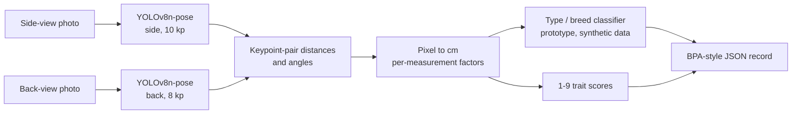

## Results

Numbers are taken from the outputs saved in `notebooks/yolo-model.ipynb`. Hardware was an RTX 3050 Ti Laptop GPU (4 GB) with Ultralytics 8.3.203.

### Pose models

| Model | Data (train / val / test) | Epochs | Val box mAP50 / 50-95 | Val pose mAP50 / 50-95 | Test box mAP50 / 50-95 |
|---|---|---|---|---|---|
| Side view, 10 kp | 96 / 14 / 28 | 200 | 0.995 / 0.974 | 0.995 / 0.916 | 0.970 / 0.935 |
| Back view, 8 kp | 49 / 8 / 15 | 198 (early stop, best at 148) | 0.995 / 0.810 | 0.995 / 0.855 | 0.995 / 0.794 |

The test-split figures come from `model.val(split="test")` in Step 1.9. That cell prints them under the labels "Precision" and "Recall", but the values are the **box** mAP50 and mAP50-95. Validation sets are very small (14 and 8 images), so treat these as sanity checks rather than benchmarks.

| Side training curves | Back training curves |
|---|---|
| 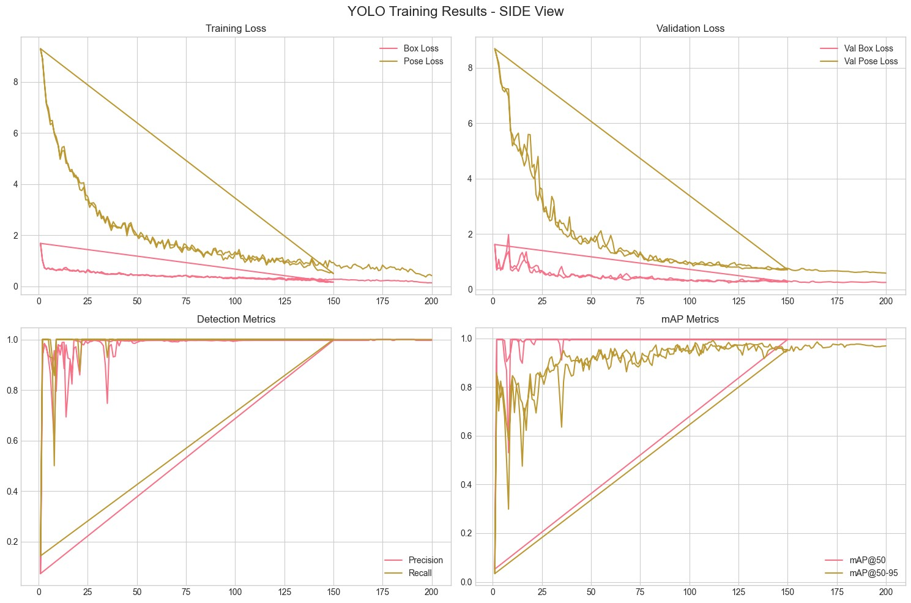 | 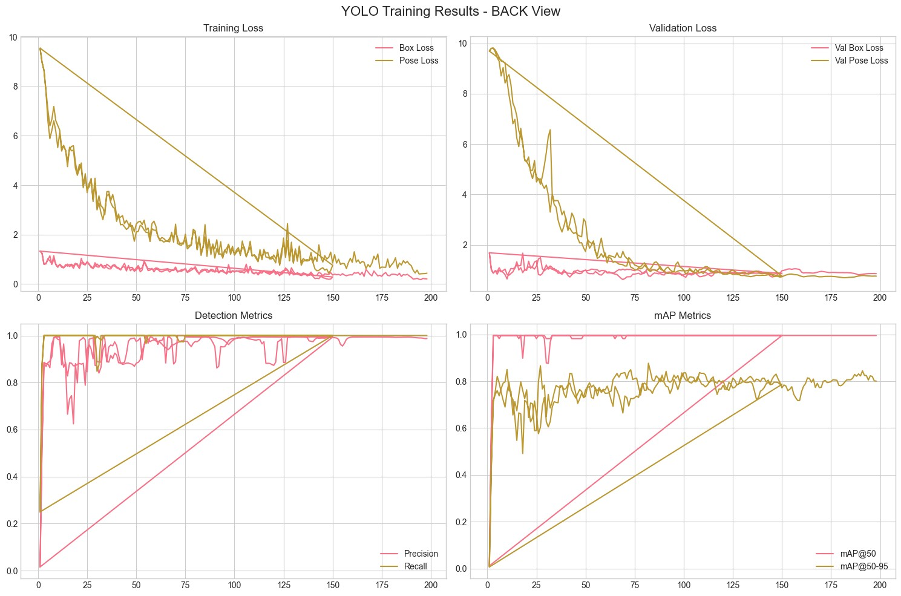 |

<details>
<summary>Ultralytics PR curves and confusion matrices</summary>

| Side pose PR | Back pose PR |
|---|---|
| 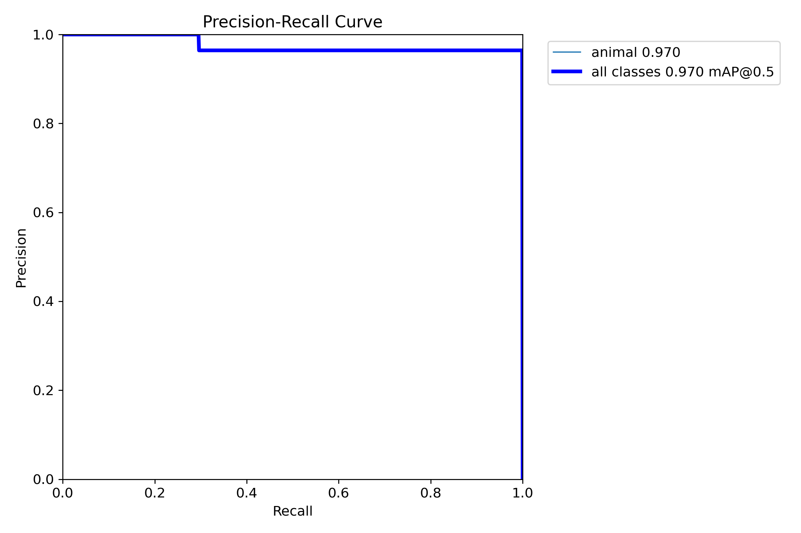 | 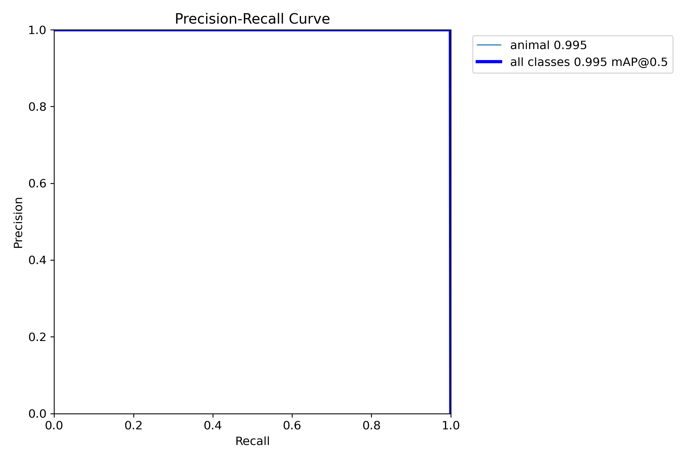 |
| 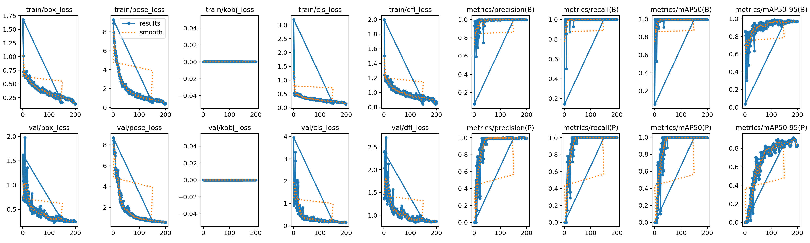 | 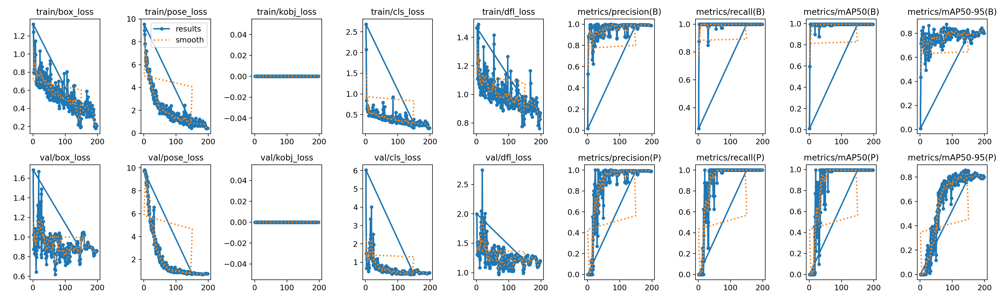 |

</details>

### Measurements

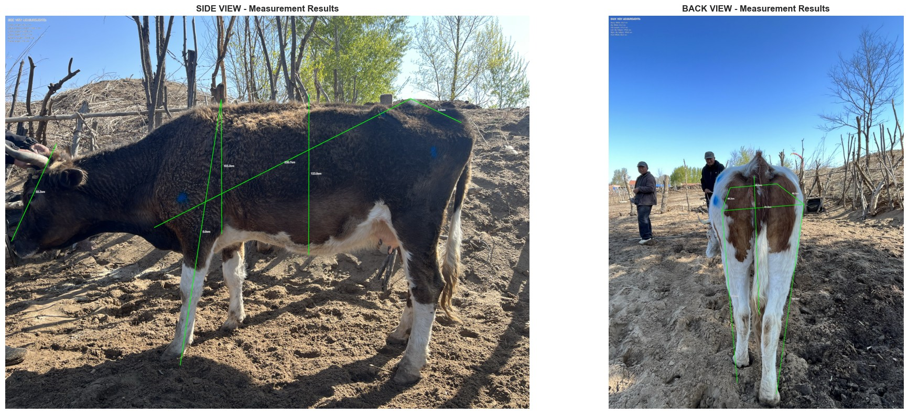

- Scaling ended up as hand-tuned per-measurement factors (0.06–0.15 cm/px) plus a single-reference calibrated factor of **0.0629 cm/px**. The attempt to calibrate from the ground-truth spreadsheet found no usable measurement columns (`Found 0 measurement columns in Excel`).
- The notebook's own plausibility check (is each value inside a biologically sensible range?) passed **4 of 6** side and **4 of 6** back measurements. It then prints an "overall accuracy" of 75%. That figure counts plausible values; it is not a comparison against tape measurements.

<details>
<summary>Comparative side/back view analysis</summary>

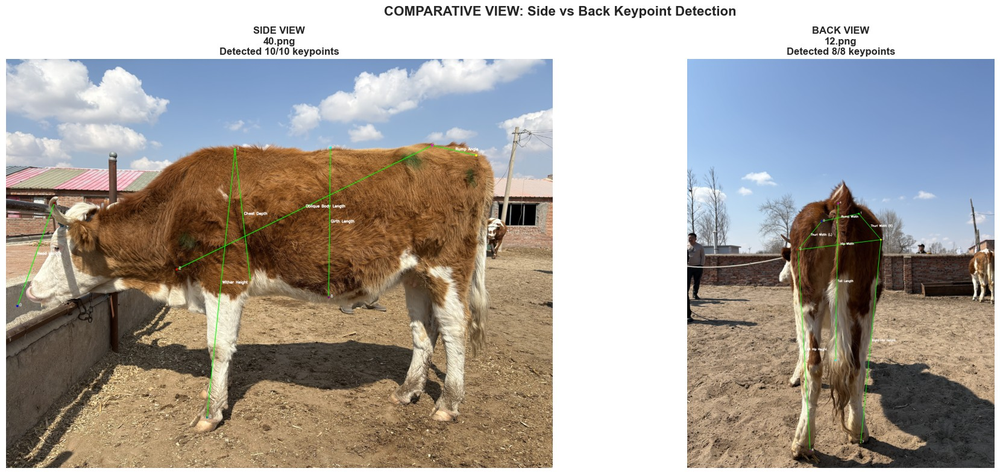
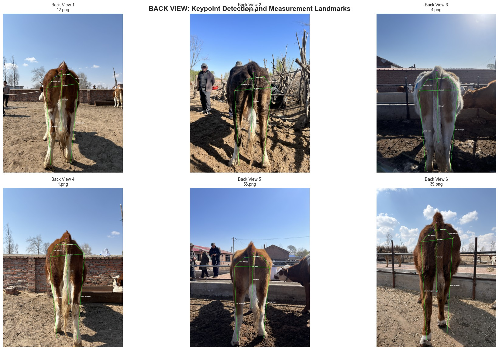

</details>

## Honest caveats

> [!IMPORTANT]
> An earlier README in this repo had a large "Detailed Performance Metrics" table (for example 96.1% animal-type accuracy, 91% breed accuracy, ±1–3 cm per measurement and "30× faster than manual"). Those values were **hard-coded strings in the demo cells**, not measured results, so they have been removed. The only measured numbers are listed above.

- **Type and breed classification is trained on synthetic data.** Step 4.3/4.12 samples measurements from hand-picked normal distributions for cattle and buffalo, using breeds Sahiwal, Gir, Jang, Murrah and Jaffrabadi. On that synthetic data the animal-type gradient-boosting model scores 0.920 on test (0.958 mean 5-fold CV). The breed models score 0.800 (cattle) and 0.867 (buffalo). The notebook then shows `demo_accuracy = max(accuracy, 0.91)` in its demo output. None of this has been checked on real labelled animals.
- **Trait scores** (`results/*.json`) come from fixed thresholds on the measurements. They are not calibrated against expert scoring.
- The demo notebook `yolo-model-demo.ipynb` is a presentation copy of the main notebook. Run outputs live in `yolo-model.ipynb`.

## Missing artefacts

This repository was first pushed with **Git LFS pointer files whose objects were never uploaded**, so GitHub had only the 130-byte pointers. During the clean-up:

- 11 files were restored from byte-identical copies in [VETRA-v2.2-with-app](https://github.com/rupeshbharambe24/VETRA-v2.2-with-app): base weights and several YOLO training-batch images.
- The figures in `results/figures/` were **re-exported from the image outputs saved inside `notebooks/yolo-model.ipynb`**, which belong to the same run.
- 33 pointers had no recoverable content and were removed. They include the trained `weights/best.pt` and `last.pt` for both views, the runs' `results.csv`, some batch images, the two example photos and `scaling_calibration_data.csv`. Training metrics are still visible in the notebook outputs and `runs/*/results.png`.

For inference with the same keypoint layout, use the retrained v2.2 weights in [VETRA-v2.2-with-app](https://github.com/rupeshbharambe24/VETRA-v2.2-with-app) (`runs/side_view/yolov8_cow_side_v1/weights/best.pt` and `runs/back_view/yolov8_cow_back_v1/weights/best.pt`).

## Project structure

```text
VETRA-v2.0/
├── notebooks/
│   ├── yolo-model.ipynb             # main pipeline: split, train, visualise, measure, classify, integrate (Steps 1-5)
│   ├── yolo-model-demo.ipynb        # presentation copy of the main notebook
│   ├── kpt-vis-and-analysis.ipynb   # keypoint visualisation and statistics (Step 2 standalone)
│   └── measurement-extraction.ipynb # measurement + scaling helpers (Step 3 standalone)
├── configs/
│   ├── side_view.yaml               # 10-kp side-view dataset config
│   └── back_view.yaml               # 8-kp back-view dataset config
├── models/pretrained/               # yolov8n-pose.pt base weights (+ yolo11n.pt from the Ultralytics AMP check)
├── runs/
│   ├── side_view/yolov8_cow_side_v1/   # curves, confusion matrices, batch images
│   └── back_view/yolov8_cow_back_v1/
├── results/
│   ├── figures/                     # training curves, keypoint + measurement visualisations
│   ├── enhanced_bpa_output.json     # example end-to-end record (measurements, trait scores)
│   └── bpa_integration_output.json
├── requirements.txt
└── LICENSE
```

## Getting started

```bash
git clone https://github.com/rupeshbharambe24/VETRA-v2.0.git
cd VETRA-v2.0
python -m venv .venv && source .venv/bin/activate   # Windows: .venv\Scripts\activate
pip install -r requirements.txt
jupyter notebook notebooks/yolo-model.ipynb
```

- The datasets are **not in this repo**. To retrain, put images and YOLO keypoint labels in `data/side_view`, `data/labels_side`, `data/back_view` and `data/labels-back` (see `CONFIG` in Step 1.2). The notebook builds `yolo_side/` and `yolo_back/` and rewrites `configs/*_view.yaml`.
- The first cell moves the working directory to the repo root, so the relative paths work from any launch directory.
- Training uses `device='0'`. Change it to `'cpu'` if you have no GPU.

## Dataset

- Side view: 138 images with 10-keypoint labels. Back view: 72 images with 8-keypoint labels. Measurements come from a ground-truth spreadsheet. None of these are committed.
- Provenance is not documented. The visualisations suggest a mix of team-collected farm photos (people's faces are visible) and photos that look like they come from a public cattle-measurement dataset. **The licence is unclear.** Don't redistribute the images without checking.

## VETRA project map

VETRA (SIH 2025, Grand Finale Top 5) is split across several repositories. ML work evolved v1.1 → v2.0 → v2.2 → v3.0; the apps below consume or capture data for those models.

| Repository | What it is | Stack | Status |
|---|---|---|---|
| [VETRA-v1.1](https://github.com/rupeshbharambe24/VETRA-v1.1) | First ML experiment: 6-keypoint YOLOv8n-pose on side-view cow images + regressors mapping keypoint distances to body measurements (cm) | Python, YOLOv8-pose, scikit-learn | Archived (ML) |
| **[VETRA-v2.0](https://github.com/rupeshbharambe24/VETRA-v2.0)** (this repo) | Separate side (10 kp) and back (8 kp) YOLOv8n-pose models, per-measurement pixel-to-cm scaling, measurement extraction, prototype type/breed scoring | Python, Ultralytics | Archived (ML) |
| [VETRA-v2.2-with-app](https://github.com/rupeshbharambe24/VETRA-v2.2-with-app) | v2 pipeline retrained and wrapped in a first FastAPI backend + React UI (`/api/v1/process-image`) | Python, FastAPI, React | Archived (ML + app) |
| [VETRA-v3.0](https://github.com/rupeshbharambe24/VETRA-v3.0) | Final training: side (14 kp), back (10 kp) and udder-bottom (8 kp) YOLOv8n-pose models, udder U-Net + ResNet18, ArUco scaling, dataset tooling | Python, Ultralytics, PyTorch | Final models |
| [VETRA---App](https://github.com/rupeshbharambe24/VETRA---App) | Final system: FastAPI backend serving the v3.0 pose models + udder U-Net/ResNet18, NDDB-style trait scoring, React web UI | FastAPI, PyTorch, React + Vite | Final (SIH 2025 finale) |
| [vetra-main-app-latest-v3](https://github.com/rupeshbharambe24/vetra-main-app-latest-v3) | Flutter field app: capture protocol, offline SQLite records, PDF reports (not yet wired to the analysis API) | Flutter, Riverpod, SQLite | Prototype |
| [vetra-depth-recorder-latest-v3](https://github.com/rupeshbharambe24/vetra-depth-recorder-latest-v3) | RGB + ARCore depth capture with intrinsics, pose and ZIP export | Flutter, Kotlin, ARCore | Prototype |
| [VETRA---Depth-Recorder](https://github.com/rupeshbharambe24/VETRA---Depth-Recorder) | Earlier capture app: RGB frames + phone-sensor pose metadata (no real depth) | Expo / React Native, TypeScript | Superseded |
| [vetra-pashu-scan](https://github.com/rupeshbharambe24/vetra-pashu-scan) | Early Lovable-generated PWA UI; Supabase edge functions return mock measurements | Vite, React, Supabase | Superseded (UI prototype) |
| [pashudhan-ui](https://github.com/rupeshbharambe24/pashudhan-ui) | Fork of a teammate's Lovable UI prototype (landing page + mock prediction page) | Vite, React | Fork |

## Acknowledgements

Built by **Rupesh Bharambe** (ML, computer vision, web app; team lead) for the VETRA team at Smart India Hackathon 2025. Pose estimation uses [Ultralytics YOLOv8](https://github.com/ultralytics/ultralytics).

## License

Code is released under the [MIT License](LICENSE). Images and measurement data are not covered by it.
